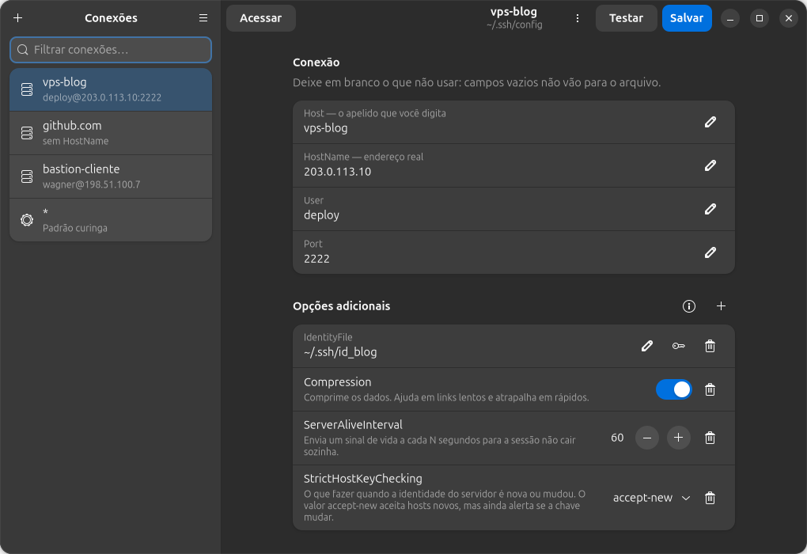
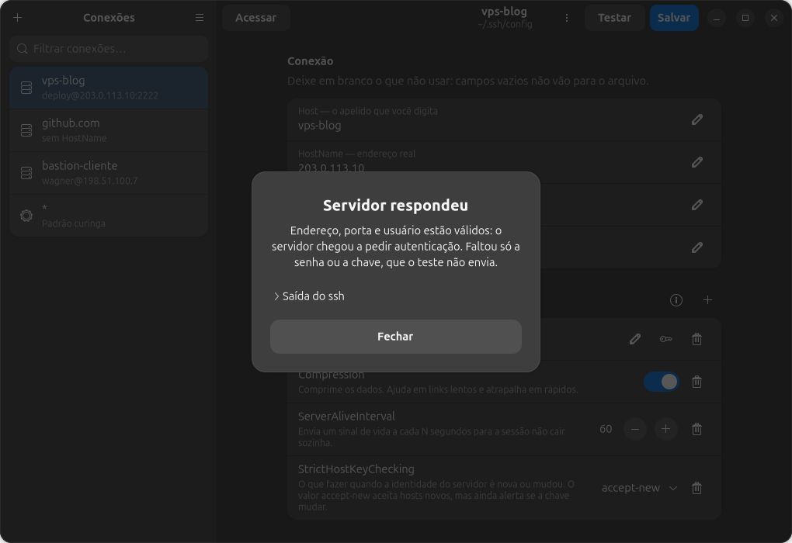
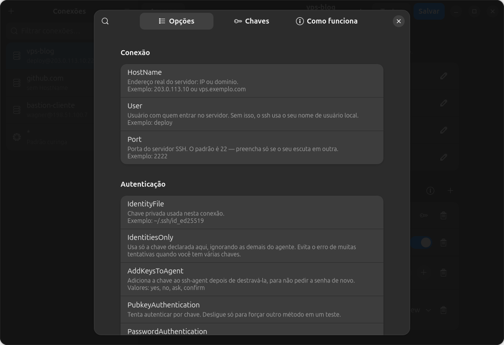

# ParvuSsh

[](https://github.com/wagnerbugs/parvussh/actions/workflows/check.yml)

**Gerencia suas conexões SSH lendo e escrevendo o seu `~/.ssh/config` de
verdade.** Sem banco paralelo, sem formato proprietário, sem etapa de
importação.

*Parvus*, do latim: pequeno. O nome é a lista de não-objetivos em uma palavra.



---

## Para quem é

Para quem cuida de alguns servidores e cansou de abrir o `~/.ssh/config` num
editor de texto só para lembrar qual apelido usou.

E para quem está começando: os campos usam o **nome real das opções do
OpenSSH**, com uma explicação em português ao lado. Você pode procurar no
`man ssh_config` exatamente o que está vendo na tela. A ideia não é esconder o
SSH de você — é te apresentar a ele.

## O que ele faz

- Lista, filtra e edita as conexões do seu `~/.ssh/config`, na ordem do
  arquivo ou por nome — ordenar muda só a lista, nunca o arquivo
- Catálogo de 50 opções do SSH, buscáveis **pelo que fazem**: digite `chave`,
  `bastion` ou `sessão` e veja o que aparece
- Cria chaves `ed25519`, `ecdsa` ou `rsa` e escolhe qual usar em cada conexão
- Testa a conexão **antes de salvar**, e explica em português o que deu errado
- **Acessar** abre o seu terminal já rodando `ssh apelido` — o mesmo comando
  que você digitaria. Qual terminal, você escolhe em Preferências (`Ctrl+,`);
  veja [Escolhendo o terminal](#escolhendo-o-terminal-do-acessar)
- Guia passo a passo de como criar uma chave e instalá-la num servidor

### O teste de conexão diz coisa útil



Repare no veredito: *"Servidor respondeu"* é um **sucesso**, mesmo o ssh tendo
recusado o login. Chegar até o pedido de autenticação já prova que o endereço,
a porta, o usuário e a rede estão certos — que é exatamente o que você queria
saber. O que faltou foi a senha ou a chave, que o teste não envia de
propósito.

Quando falha, ele diz por quê: nome não resolvido, porta fechada, firewall no
caminho, ou a identidade do servidor mudou. A saída crua do `ssh` fica ali
embaixo, dobrada, para quem quiser.

### A ajuda é parte do aplicativo



`F1` abre o catálogo inteiro com busca, um guia de seis passos sobre chaves
(criar, instalar, permissões, fechar a senha, usar o agente, e o que fazer
quando falha) e uma página explicando como o arquivo funciona — incluindo a
regra que mais surpreende: **o OpenSSH usa a primeira definição que encontrar**,
não a última.

No guia, cada comando fica num bloco à parte, com um botão de copiar por linha.
Um botão por linha de propósito: em "valide, depois recarregue", o segundo
comando só deve rodar se o primeiro passar.

---

## O contrato com o seu arquivo

Esta é a parte que ganha ou destrói a sua confiança. Cada item abaixo tem um
teste automatizado que falha se for quebrado.

1. **Bloco que você não editou volta byte por byte.** Só o bloco editado é
   reescrito. Indentação, espaçamento e ordem ficam como estavam.
2. **Comentários sobrevivem.** Cada comentário pertence à linha logo abaixo
   dele e viaja junto com ela.
3. **Opções desconhecidas sobrevivem.** Uma opção que não está no nosso
   catálogo vira um campo de texto comum. Nunca é descartada por ser
   desconhecida.
4. **Backup antes de cada gravação**, em `<config>.bak-AAAAMMDD-HHMMSS`, com
   permissão 600 (`-2`, `-3` se duas gravações caírem no mesmo segundo). Uma
   cópia que já existe nunca é sobrescrita, e se a cópia falhar, nada é
   gravado. Ficam as 3 cópias mais novas — mais nova pela data no nome; o
   número muda em Preferências — e as mais velhas vão para a **Lixeira**, de
   onde dá para restaurar. Nenhuma cópia é apagada direto.
5. **Validação antes de gravar.** O conteúdo vai para um arquivo temporário e
   passa por `ssh -G`. Se o ssh recusar, **nada** é gravado e a mensagem dele
   aparece para você.
6. **Gravação atômica.** Arquivo temporário na mesma pasta, `chmod 600`,
   `os.replace`. Ou o arquivo antigo está lá, ou o novo — nunca metade.
7. **Nunca escrevemos num arquivo que não lemos.** Os arquivos trazidos por
   `Include` são editáveis justamente porque foram carregados; nada além
   disso é tocado. A única exceção são as cópias antigas do item 4, e só as
   que têm exatamente o nome `<arquivo>.bak-AAAAMMDD-HHMMSS` (ou com `-2`,
   `-3`…): uma cópia que você fez à mão com outro nome nunca é tocada.
8. **Mudanças de outros programas sobrevivem.** Antes de gravar, o arquivo é
   lido de novo. Se outro programa — um script de provisionamento, o seu
   editor de texto — mexeu nele desde que o aplicativo o abriu, a sua edição
   é reaplicada sobre o conteúdo novo, e a mudança dele fica. Se as duas
   caíram no mesmo trecho, nada é gravado e o aplicativo pede para você
   repetir a edição sobre o arquivo atual. E a lista acompanha o arquivo:
   quando outro programa grava nele e não há edição sua pendente, ela se
   atualiza sozinha.

Um detalhe do mesmo espírito: se uma opção tiver um valor que o widget certo
não conseguiria guardar — `ConnectTimeout 99999`, `Compression maybe` — ela
aparece como texto puro em vez de virar um seletor que truncaria o valor no
próximo Salvar.

---

## Instalação

Mínimo: Python 3.11, GTK 4.12, libadwaita 1.5. Desenvolvido no Ubuntu 26.04
com GNOME 50, mas nada aqui é específico do Ubuntu.

Esse mínimo de GTK é o filtro que importa, e ele exclui distribuições
estáveis: um Debian 12 ou um Linux Mint 21 têm GTK anterior a 4.12 e o
aplicativo não abre. Para saber onde a sua máquina está antes de clonar:

```bash
python3 tools/check_stack.py
```

Ele informa as versões encontradas e, se faltar alguma coisa, imprime o comando
de instalação do gerenciador de pacotes que você usa — `apt`, `pacman` ou
`dnf`. Nenhum comando é executado por ele; a linha é sua para conferir e rodar.

Depois disso:

```bash
git clone https://github.com/wagnerbugs/parvussh.git
cd parvussh
make setup
```

O `make setup` verifica o sistema e cria o `.venv`. Ele **não** instala pacotes
do sistema nem chama `sudo`: essa parte é da sua distribuição, e o comando sai
do `check_stack.py` acima. Não há dependências de runtime no PyPI — o PyGObject
vem da distribuição de propósito, porque é o caminho que funciona sem dor de
compilação.

Para abrir pelo menu do GNOME, em vez de pelo terminal:

```bash
make install-user
```

Instala o `.desktop` e os ícones em `~/.local/share`. Sem `sudo`, nada fora da
sua pasta pessoal é tocado. Para desfazer: `make uninstall-user`.

### Flatpak — quando o GTK da sua distribuição é antigo demais

É a saída para o Debian 12 e o Mint 21 citados acima: o Flatpak carrega o
próprio GTK, então a versão que a sua distribuição tem deixa de importar.

```bash
flatpak remote-add --if-not-exists --user flathub \
    https://dl.flathub.org/repo/flathub.flatpakrepo
flatpak install --user flathub org.gnome.Platform//51 org.gnome.Sdk//51
make flatpak
```

O último comando constrói a partir da árvore atual e instala para o seu
usuário. Depois disso o ParvuSsh aparece no menu como qualquer outro
aplicativo, ou abre com `make flatpak-run`. Para remover: `make
flatpak-uninstall`.

O `ssh` que ele usa continua sendo **o seu**, não uma cópia dentro do pacote —
com o seu `ssh-agent`, o seu `known_hosts` e o seu `ProxyCommand`. É decisão
de projeto: uma cópia empacotada seria outro programa, com outra versão, e
deixaria de funcionar justamente nas opções que dependem da sua máquina.

Para chamar pelo terminal, o comando fica atrás do `flatpak run`. Uma linha no
seu `~/.bashrc` resolve:

```bash
alias parvussh='flatpak run --command=parvussh io.github.wagnerbugs.ParvuSsh'
```

### Chamando pelo nome, de qualquer pasta

Depois do `make setup`, digitar `parvussh` no terminal ainda responde
`comando não encontrado`. Não é erro seu: o comando existe, mas dentro do
ambiente virtual do projeto, em `.venv/bin/parvussh`, e essa pasta não está no
seu `PATH`. Três saídas, da mais imediata à definitiva.

**Caminho completo.** Funciona já, de dentro da pasta do projeto:

```bash
.venv/bin/parvussh --list
```

**Ativar o venv.** Enquanto aquele terminal estiver ativado, o nome existe:

```bash
source .venv/bin/activate
parvussh --list
deactivate
```

**Um link em `~/.local/bin`** — a recomendada, e a única que vale para sempre:

```bash
ln -s ~/projects/parvussh/.venv/bin/parvussh ~/.local/bin/parvussh
```

Troque o caminho pelo lugar onde você clonou. `~/.local/bin` já está no `PATH`
na maioria das distribuições; se não estiver, o seu shell dirá o mesmo
`comando não encontrado` e a correção é acrescentar a pasta no `~/.bashrc`.

Melhor que um `alias` por dois motivos: um alias só vale no terminal
interativo que o definiu, e portanto não funciona em script, `cron` ou
`xargs`; e o link acompanha o clone, então um `git pull` atualiza o comando
junto. O script tem o interpretador do venv escrito nele por caminho absoluto,
então o link encontra tudo sozinho, de qualquer pasta, sem ativar nada.

Para desfazer: `rm ~/.local/bin/parvussh`.

---

## Uso

```bash
make run
```

| Atalho | O que faz |
|---|---|
| `Ctrl+N` | nova conexão |
| `Ctrl+S` | salvar |
| `Ctrl+,` | preferências |
| `F1` | ajuda |

### Escolhendo o terminal do Acessar

O botão **Acessar** abre o terminal padrão do sistema — no Ubuntu com GNOME, o
Ptyxis. Para usar outro, abra as Preferências (`Ctrl+,`), escreva o comando
dele em **Comando do terminal** e confirme com `Enter`. A linha **Em uso**,
logo abaixo, diz qual terminal o botão vai abrir. Campo vazio volta ao padrão.

**O que é o `-e`.** Um terminal é uma janela que roda um programa dentro dela —
normalmente o seu shell, o `bash`. Para ele rodar outra coisa no lugar, como o
`ssh hostinger`, é preciso avisar onde acabam as opções do terminal e onde
começa o comando. Cada terminal escolheu um sinal para isso, e o `-e` (de
*execute*, executar) é o mais comum. O aplicativo põe o comando logo depois do
que você escreveu:

```
/usr/bin/ghostty -e   /bin/sh -c "… ssh hostinger …"
└── você escreve ──┘  └─── o aplicativo acrescenta ───┘
```

O que vem depois do `-e` é um script curto: ele mostra `$ ssh hostinger` na
tela, roda o comando e, se a conexão falhar, segura a janela aberta até você
apertar `Enter`, para dar tempo de ler o erro. Sem o `-e`, o terminal não sabe
o que fazer com aquele `/bin/sh` e fecha na hora — é o aviso de que ele
"encerrou logo ao iniciar".

Os sinais que você vai encontrar:

| Sinal | Terminais |
|---|---|
| `-e` | xterm, Ghostty, Alacritty, Konsole |
| `--` | Ptyxis, GNOME Terminal, WezTerm (depois de `start`) |
| `-x` | Xfce Terminal |
| nenhum | kitty, foot — o comando vai direto depois das opções |

O `--` não é invenção de terminal: é uma convenção antiga do Unix que quer
dizer "minhas opções acabaram, o resto não é para mim". Funciona em muitos
comandos — `rm -- -arquivo-com-hifen` apaga um arquivo cujo nome começa com
hífen, em vez de achar que é uma opção.

**Exemplos.** Vale o caminho completo ou só o nome, se o programa estiver no
`PATH` — a lista de pastas onde o sistema procura comandos, que você vê com
`echo $PATH`.

| Para abrir | Comando do terminal |
|---|---|
| o padrão do sistema | *(vazio)* |
| xterm | `/usr/bin/xterm` |
| xterm, com letra legível | `/usr/bin/xterm -fa Monospace -fs 13 -e` |
| Ghostty | `/usr/bin/ghostty -e` |
| Ghostty, com letra maior | `/usr/bin/ghostty --font-size=14 -e` |
| Alacritty | `alacritty -e` |
| WezTerm | `wezterm start --` |
| kitty | `kitty` |
| foot | `foot` |

Os do xterm e o primeiro do Ghostty foram testados de verdade. Os outros vêm do
manual de cada programa; se algum não abrir, a ajuda dele diz o sinal certo
(veja abaixo).

**Quando o sinal entra sozinho.** Se você escrever *só* o caminho de um
terminal que o aplicativo conhece, ele mesmo acrescenta o sinal: por isso
`/usr/bin/xterm` funciona sem `-e`. Ele conhece o Ptyxis, o GNOME Terminal, o
Console (`kgx`), o Konsole, o Xfce Terminal, o xterm e o `x-terminal-emulator`
do Debian. Para qualquer outro, ou quando você acrescenta opções suas — como a
fonte do xterm —, o aplicativo usa exatamente o que está escrito, então o sinal
vem no fim, escrito por você. É por isso que `/usr/bin/ghostty` sozinho dá
erro e `/usr/bin/ghostty -e` funciona.

**Descobrindo o sinal de outro terminal.** Procure por *execute* ou *command*
na ajuda dele:

```bash
ghostty --help | grep -- -e   # "A special command line argument `-e <command>` …"
man xterm                     # dentro do man, digite /-e program e Enter
```

**Por que o xterm abre minúsculo.** Ele é de 1984, e a fonte padrão dele é um
desenho de 6×13 pixels que não acompanha a escala da tela. Maximizar a janela
não ajuda: dá mais linhas e colunas, não letra maior — isso vale para qualquer
terminal. `-fa Monospace` troca pela fonte do sistema e `-fs 13` define o
tamanho; a janela cresce junto. Com ela já aberta, `Shift` + `+` do teclado
numérico também aumenta a letra.

### Listando do terminal

Quando a dúvida é só "qual apelido eu usei mesmo?", não precisa abrir a janela:

```bash
parvussh --list
```

(chamar pelo nome curto supõe o link de
[Chamando pelo nome](#chamando-pelo-nome-de-qualquer-pasta); sem ele, use
`.venv/bin/parvussh --list`)

```
hostinger  deploy@198.51.100.10:65002
gps        root@203.0.113.24
home       dev@192.168.1.20
```

Uma linha por conexão, alinhada para bater o olho. Um bloco sem `HostName`
aparece dito com todas as letras, e um bloco curinga como `Host *` é marcado
como padrão, não como conexão incompleta. Se algum `Include` trouxe outros
arquivos, uma terceira coluna diz de qual arquivo veio cada bloco.

O comando só lê: não cria o `~/.ssh/config` se ele ainda não existir, e não
carrega nada de GTK — funciona por ssh, numa máquina sem ambiente gráfico.

### Idioma

A interface existe em **português e inglês**, e escolhe sozinha a partir do seu
sistema (`LC_ALL`, `LC_MESSAGES` ou `LANG`). Trocar o idioma do GNOME troca o
do aplicativo junto — é como aplicativos GNOME funcionam, e por isso não há
seletor de idioma dentro dele.

Para uma execução avulsa:

```bash
PARVUSSH_LANG=en make run     # inglês
PARVUSSH_LANG=pt_br make run  # português
```

Para fixar no lançador do menu, sem mexer no sistema:

```bash
make install-user PARVUSSH_LANG=en
```

Sem o argumento, `make install-user` volta a seguir o sistema. Um idioma que o
aplicativo não fala é recusado com a lista dos que ele fala.

### Testando sem arriscar o seu arquivo

Enquanto você não confia no aplicativo, aponte ele para um `HOME` descartável:

```bash
mkdir -p /tmp/parvussh-teste/.ssh && chmod 700 /tmp/parvussh-teste/.ssh
cp ~/.ssh/config /tmp/parvussh-teste/.ssh/config
HOME=/tmp/parvussh-teste .venv/bin/python -m parvussh
```

O aplicativo resolve tudo a partir de `Path.home()`, então ele lê e grava
apenas dentro de `/tmp/parvussh-teste/.ssh`. Edite, salve, quebre à vontade, e
compare com `diff`. Seu arquivo real fica intocado.

### Se mexer no arquivo real e se arrepender

```bash
ls ~/.ssh/config.bak-*                                # o mais recente por último
diff ~/.ssh/config ~/.ssh/config.bak-20260728-183000
cp ~/.ssh/config.bak-20260728-183000 ~/.ssh/config    # voltar atrás
```

As cópias mais velhas que essas estão na Lixeira: no Arquivos, abra a
Lixeira, clique com o botão direito na cópia e escolha **Restaurar**.

---

## Limitações conhecidas

**A senha da chave aparece no `ps` por um instante.** Ao criar uma chave, o
aplicativo passa a senha como argumento para o `ssh-keygen`, então outro
usuário logado na mesma máquina consegue vê-la enquanto o comando roda. Num
desktop pessoal isso é aceitável. Se não for o seu caso, crie a chave no
terminal — `ssh-keygen -t ed25519 -C "seu-nome@notebook"` — e depois use o
botão de chave para selecioná-la.

**Blocos `Match` são somente leitura.** Eles são lidos, preservados e gravados
de volta intactos, mas não aparecem na lista nem podem ser editados pela
interface. Edite-os no seu editor de texto; o aplicativo não vai atrapalhar.

---

## Filosofia

O formato é o `ssh_config`, sempre. O aplicativo é uma janela para um arquivo
que já era seu antes de ele existir, e continua sendo depois. Se você desinstalar
o ParvuSsh amanhã, nada quebra — suas conexões continuam funcionando no
terminal, no `scp`, no `rsync` e no Git, porque nunca deixaram de morar onde
sempre moraram.

O único arquivo que o aplicativo guarda para si é
`~/.config/parvussh/settings.ini`, com o terminal escolhido em Preferências,
quantas cópias do config guardar e a ordem da lista. Nenhuma conexão mora nele;
apagá-lo só devolve o terminal padrão do sistema, as 3 cópias e a ordem do
arquivo.

Isso é o oposto de um gerenciador que importa suas conexões para um banco
próprio. Aquele modelo pede confiança e cobra dependência. Este pede confiança
uma vez, na hora de gravar, e devolve o controle em seguida.

## Não-objetivos

Estas coisas não vão entrar. A lista curta é o que mantém o aplicativo pequeno,
e pedidos que caem nela são fechados com um obrigado.

- Terminal embutido — o botão Acessar abre o *seu* terminal, não um dentro do
  aplicativo
- Orquestração de túneis e port-forward (as opções existem no formulário;
  gerenciar sessões vivas é outro produto)
- Cofre de senhas — isso é o `ssh-agent` e o chaveiro do sistema
- Sincronização na nuvem, contas, telemetria
- Navegação SFTP, edição remota de arquivos
- Um formato próprio de configuração
- Abstrair o SSH: os rótulos usam os nomes reais das opções de propósito

---

## Desenvolvimento

| Comando | O que faz | Precisa de tela? |
|---|---|---|
| `make run` | abre o aplicativo | sim |
| `make test` | testes de lógica pura, rápidos | não |
| `make test-gui` | testes de interface, sob `xvfb` | não |
| `make lint` | `ruff check` + `ruff format --check` | não |
| `make check` | os três acima, em ordem | não |
| `make screenshots` | regera as imagens deste README | não |

Rode `make check` antes de cada commit. Veja
[`CONTRIBUTING.md`](CONTRIBUTING.md) — em inglês, como todo o código.

## Licença

GPL-3.0-or-later. Veja [`LICENSE`](LICENSE).
